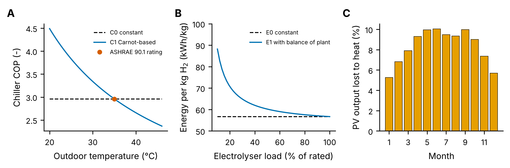
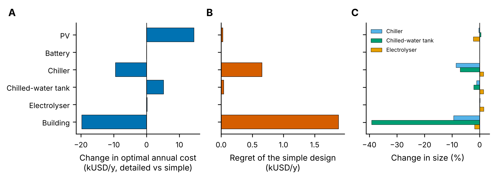
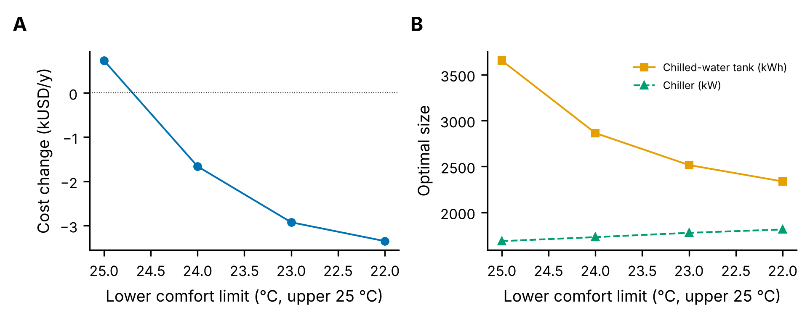

# Muscat Energy Hub: How Much Model Detail Does a Multi-Energy Sizing Study Need?

A cooling-led community energy hub in Muscat, Oman: 60 villas on district cooling, rooftop PV, a battery, an air-cooled chiller plant with a chilled-water tank, and a PEM electrolyser with a hydrogen tank supplying a small fuel-cell vehicle fleet. The question is methodological: **every component is modelled at two levels of detail, and the study measures which levels change the optimal design and which do not.**

| Component | Simple model | Detailed model |
|---|---|---|
| PV | irradiance x (1 - system loss) | plus cell temperature from the module NOCT and its power coefficient |
| Battery | lossless | 85 % round trip, 4 h, 5 % reserve; and a cycle-wear cost |
| Chiller | constant COP at the ASHRAE 90.1 rating point | Carnot-based COP vs outdoor temperature, anchored at the same point |
| Chilled-water tank | lossless | 90 % storage efficiency |
| Electrolyser | constant 56.7 kWh/kg, any load | stack 53.2 kWh/kg plus balance of plant whenever on, 10 % minimum load (on/off decisions, MILP) |
| Buildings | load from a thermostat simulation | 2R2C villa model inside the optimisation, comfort band (thermal mass usable as storage) |

Every device property comes from a datasheet, a standard or an agency dataset, and every value has its source in `params.py` (rendered in [`docs/parameters.md`](docs/parameters.md)). Cost data come from the PyPSA technology-data tables (Danish Energy Agency catalogues), so they can be updated in one place. Inputs that remain uncertain have a range and are sampled together in an uncertainty analysis.



*A: chiller COP, constant vs temperature-dependent, both through the ASHRAE 90.1 rating point. B: electrolyser energy per kg; balance-of-plant power drawn whenever the stack is on makes part load expensive. C: share of PV output lost to cell heating in Muscat (LONGi Hi-MO 6 datasheet coefficient).*

## Data

- **Weather:** PVGIS 5.2 typical meteorological year for Muscat (European Commission JRC), fetched by a GitHub Actions job (`.github/workflows/fetch_weather.yml`) into `data/`.
- **Villa:** geometry, construction, glazing, infiltration, set-point and internal gains of the base-case villa in *Energy saving potential for residential buildings in hot climates: the case of Oman* (Sustainable Cities and Society, 2019); thermal mass from ISO 13790. Cooling the whole villa all year gives about 200 kWh/m2 of electricity, at the top of the 53-199 kWh/m2 range the same paper measured in 50 Muscat homes. `calibrate_villa.py` fits the one uncertain input, the share of the villa cooled at a time, to the measured mean of 113 kWh/m2 (result: 46 %).
- **Devices:** LONGi Hi-MO 6 datasheet (PV temperature coefficient, NOCT), Nel PEM 100 datasheet (stack and system energy, 10 % minimum load), ASHRAE 90.1 (chiller rating point), NREL ATB 2024 (battery efficiency and life), HPAC (chilled-water storage efficiency).
- **Costs:** PyPSA technology-data `costs_2025.csv`, from the Danish Energy Agency catalogues (PV, battery, water tank storage, hydrogen tank); a manufacturer price for an air-cooled screw chiller; IEA Global Hydrogen Review 2024 for the electrolyser.
- **Tariffs:** import at the Omani business price (GlobalPetrolPrices); export at the 2026 Oman bulk supply tariff, which varies by month, weekday and hour (night and afternoon peaks in May-September). Exports are limited to the PV output, so the hub cannot buy cheap power to resell.

## Method

- **Time series:** one representative week per month (the week closest to the monthly mean temperature and irradiation), weighted to a year, each week cyclic. Checked against the full 8,760-hour year with the simple models (within 3 %, asserted in `checks.py`).
- **Optimisation:** Pyomo with HiGHS. Sizes and hourly operation are optimised together; with the detailed electrolyser the on/off decisions make the rating bilinear, so the rating is searched in an outer loop.
- **Regret:** the design found with simple models is re-run with detailed models (sizes fixed, operation re-optimised) and compared with the design optimised with the detailed models. This is the cost of having designed with the wrong level of detail.
- **Uncertainty:** 13 uncertain inputs (all costs, the discount rate, chiller rating and condenser approach, import price, export tariff level, measured villa consumption, backup hydrogen price) are sampled together with a Latin hypercube; for every sample the simple and detailed designs, the regret and the value of the thermal mass are recomputed (`uncertainty.py`).
- **OMEGAlpes:** the detailed chiller and electrolyser are also written as OMEGAlpes units (see below), and one week of the hub rebuilt in OMEGAlpes reproduces the Pyomo results exactly, with simple and with detailed models.

## Results

All on 12 representative weeks; costs are annualised investment and O&M plus net grid cost, USD per year (`results/`).

**Detail changes the cost estimate, but the design mainly where cooling storage is involved.**

| Component made detailed | Optimal cost | Design change | Regret of the simple design |
|---|---|---|---|
| PV (cell temperature) | +5.4 % (8.5 % less PV energy) | none: PV fills the available roofs either way | 27 USD/y |
| Battery (losses, wear) | none | none: a battery is never built, even at 200 USD/kWh | 0 |
| Chiller (COP vs temperature) | -3.5 % (cool hours run more efficiently) | chiller -9 %, tank -7 % | 0.7 kUSD/y |
| Chilled-water tank (losses) | +1.9 % | tank -2 % | 0.04 kUSD/y |
| Electrolyser (minimum load, balance of plant) | +0.1 % | rating +2 % | 1 USD/y |
| Buildings (thermal mass in the optimisation) | -7.3 % | **chilled-water tank -39 %**, chiller -9 % | **1.9 kUSD/y** |
| All detailed together | -3.7 % | tank 5,770 to 2,516 kWh, chiller 2,140 to 1,778 kW | **5.3 kUSD/y (2.0 %)** |



*A: change in the optimal annual cost when one component is modelled in detail. B: regret, the extra cost of the design found with the simple model, operated with the detailed one. C: change in the optimal sizes.*

**Part of the cold storage is in the buildings.** Step 2 separates the effect of the comfort band. Held at exactly 25 C, the building model inside the optimisation gives the same cost as the thermostat simulation (within 0.3 %), which checks the two implementations against each other. Letting the indoor temperature drop to 24, 23 or 22 C before the evening cuts the annual cost by 0.6, 1.1 and 1.3 % and the chilled-water tank from 3,719 to 2,864, 2,516 and 2,337 kWh; the chiller grows slightly (1,695 to 1,814 kW) because it pre-cools the buildings.



*A: annual cost against a fixed 25 C thermostat, as the lower comfort limit is relaxed. B: optimal chilled-water tank and chiller sizes.*

**Storage cost (step 3).** At the reference cost (30 USD/kWh, a large water tank) the tank and the buildings share the job. At 50 USD/kWh the tank shrinks to 967 kWh, and at 250 USD/kWh it disappears and the buildings do all the shifting (cost +1.8 %). Battery cost between 200 and 500 USD/kWh changes nothing: exports are paid at the bulk supply tariff and cold is cheaper to store than electricity.

**Uncertainty.** The Latin hypercube analysis over all uncertain inputs (`uncertainty.py`) is being finalised; its results will be added here.

**What this means for a sizing study.** Simple linear models are adequate for PV, chiller, battery and electrolyser *sizing* here; their detail moves the cost estimate (PV and chiller by 4-5 %) but hardly the design. The simplification that costs money is treating the cooling demand as fixed: it hides the thermal mass, so the design over-sizes the chilled-water tank and the chiller.

## The OMEGAlpes extension

[`omegalpes_ext/`](omegalpes_ext) adds the two detailed component models to OMEGAlpes 0.5 as ordinary units, so they can be used in any OMEGAlpes project ([documentation](docs/omegalpes_ext.md)):

- `AirCooledChiller`: electricity in, cold out, heat rejected to the air, with a COP that follows the outdoor temperature hour by hour (Carnot-based, anchored at the ASHRAE 90.1 rating point). The built-in `HeatPump` has a single constant COP.
- `PEMElectrolyser`: on/off state, minimum stack load and balance-of-plant power drawn whenever the unit is on (Nel PEM 100 data). The built-in `Electrolysis` unit is a constant efficiency.

Seven unit tests (`tests/`) check the energy balances, the datasheet operating points, the minimum load and that a constant COP reproduces the built-in heat pump. As a system test, one July week of the hub built from these units in OMEGAlpes gives the same cost, storage sizes and grid exchanges as the Pyomo model to six digits (`omegalpes_crosscheck.py`, `results/crosscheck_result.json`).

## Running it

```bash
python -m venv .venv && source .venv/bin/activate      # Windows: .venv\Scripts\activate
pip install -r requirements.txt
python calibrate_villa.py          # writes data/villa_calibration.json (seconds)
python run_all.py --quick          # installation test: two weeks, 1-2 min
python run_all.py                  # full study: about 30 min on 2 cores
python uncertainty.py --n 20       # uncertainty analysis, about 1 h on 2 cores
python make_figures.py
python make_params_table.py        # docs/parameters.md from params.py

# OMEGAlpes extension, tests and cross-check, in a separate environment
# (OMEGAlpes 0.5 needs PuLP 2 and pandas 2.2)
python -m venv .venv-omg && .venv-omg/bin/pip install -r requirements-omegalpes.txt pytest
.venv-omg/bin/python -m pytest tests
python crosscheck_inputs.py
.venv-omg/bin/python omegalpes_crosscheck.py
```

Run times are for a 2-core cloud machine; a recent laptop with 4-8 cores is at most about twice as fast, because most of the time is spent in single-threaded MILP branching.

**Safeguards.** `run_all.py` first runs `checks.py`: weather completeness and plausibility, PV yield, the building calibration, an equation-level check that the building model inside the optimisation reproduces the stand-alone thermostat simulation, and the representative weeks against the full year. Every case is written to `results/*.csv` as soon as it finishes and a rerun skips finished cases, so an interrupted run resumes where it stopped. When HiGHS does not reach the requested gap on a MILP (time limit, or an incumbent rejected by its final feasibility check), the solver falls back to the LP relaxation, rounds the electrolyser on/off pattern, completes it with an LP and logs the distance to the relaxation bound. Everything is logged to `results/run.log`.

## Limitations

- Representative weeks, not the full year, for the detailed cases.
- One villa type, scaled by a calibrated cooled share; no occupant diversity.
- The chiller COP curve is thermodynamic (fixed second-law efficiency) anchored at the rating point, not a manufacturer part-load map; the rating and condenser approach are varied in the uncertainty analysis.
- Costs are recent published averages, not Omani quotations; the chiller installation factor (1.5 times equipment price) and the roof share usable for PV (50 %) are assumptions, the first covered by the cost range in the uncertainty analysis.
- The hydrogen demand (20 kg/day for a small vehicle fleet) is a scenario, not a forecast.

## Files

```
params.py               every input with unit, status, source and uncertainty range
weather.py              PVGIS TMY, PV models, representative weeks
building.py             2R2C villa model and thermostat simulation
calibrate_villa.py      fits the cooled share of the villa to measured Muscat data
hub.py                  Pyomo model with simple and detailed component models
sizing.py               sizing, with the outer electrolyser search
experiments.py          steps 1-3, resumable
uncertainty.py          Latin hypercube uncertainty analysis, resumable
checks.py               consistency checks
run_all.py              runs everything with logging
make_figures.py         figures
omegalpes_ext/          AirCooledChiller and PEMElectrolyser units for OMEGAlpes
tests/                  unit tests of the OMEGAlpes units
crosscheck_inputs.py, omegalpes_crosscheck.py   OMEGAlpes system cross-check
```
